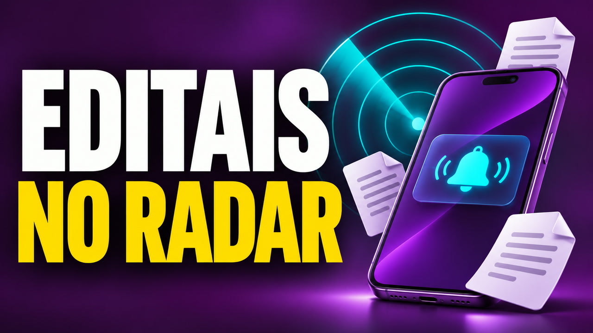

# Robô de editais com IA

Configure sua IA para encontrar **editais, chamadas públicas e bolsas** que combinam com seu perfil. A skill orienta a busca em fontes oficiais, explica quem pode se candidatar e ajuda a montar uma rotina de alertas sem avisos repetidos.

[Ver a skill](robo-de-editais-com-ia/SKILL.md) · [Guia ilustrado na LevanteLab](https://levantelab.com.br/skills/robo-de-editais-com-ia)

## O que você consegue montar

| Etapa | Resultado |
| --- | --- |
| Definir o perfil | Critérios para quem pesquisa, ensina, atua no serviço público ou busca fomento |
| Buscar na fonte | Documento vigente, retificações, prazo e trecho que comprova a regra |
| Triar oportunidades | Aviso, revisão para parceria ou arquivo com justificativa |
| Ativar os alertas | Frequência, canal e histórico para evitar envios repetidos |

## Comece no chat

1. Abra o [SKILL.md](robo-de-editais-com-ia/SKILL.md) e anexe o arquivo a um chat que aceite documentos ou cole o conteúdo.
2. Use a mensagem abaixo, adaptando o perfil.
3. Envie um edital oficial conhecido para validar a primeira leitura.

~~~text
Use a skill Robô de editais com IA. Sou doutoranda e busco
bolsas de até seis meses em educação pública. Quero revisar
editais que aceitem parceria via universidade. Comece pelo meu
perfil e valide um edital comigo antes de agendar a busca.
~~~

## Instale como Agent Skill

Em um agente que reconheça o formato [Agent Skills](https://agentskills.io/specification), copie a pasta inteira **robo-de-editais-com-ia/** para o diretório de skills documentado pelo seu agente. Mantenha o nome da pasta e o arquivo **SKILL.md** juntos. Abra uma sessão e peça para usar a skill para configurar seu radar.

## Escolha fontes e teste a rotina

Comece pelos portais oficiais das instituições relevantes para seu perfil. Para reduzir ruído, combine palavras-chave de tema e tipo de apoio com requisitos objetivos, como vínculo, região e antecedência mínima para preparar a proposta.

| Caso de teste | O que conferir |
| --- | --- |
| Chamada aberta, com perfil elegível | Um alerta com prazo, evidência e URL oficial |
| Proposta precisa ser apresentada por outra instituição | Uma pergunta a resolver e indicação de possível parceria |
| Chamada vencida | Registro arquivado, sem aviso |
| Mesmo edital em duas rodadas | Zero novos avisos na segunda rodada |
| Retificação oficial muda o prazo | Um aviso de atualização com a mudança explicada |

## Como funciona o agendamento

A skill é um guia para o agente. Para executar buscas e entregar avisos fora do chat, o ambiente precisa ter agendamento, acesso às fontes, histórico persistente e um canal de envio configurado. Comece no modo manual e confirme a primeira execução real no canal escolhido.

## Contribua com casos de teste

Ao relatar uma falha, inclua o link público do edital, a seção relevante e o resultado esperado. Remova dados pessoais de perfis, credenciais e endereços de destinatários.

Criado para o episódio **Robô de Editais**, da LevanteLab.
